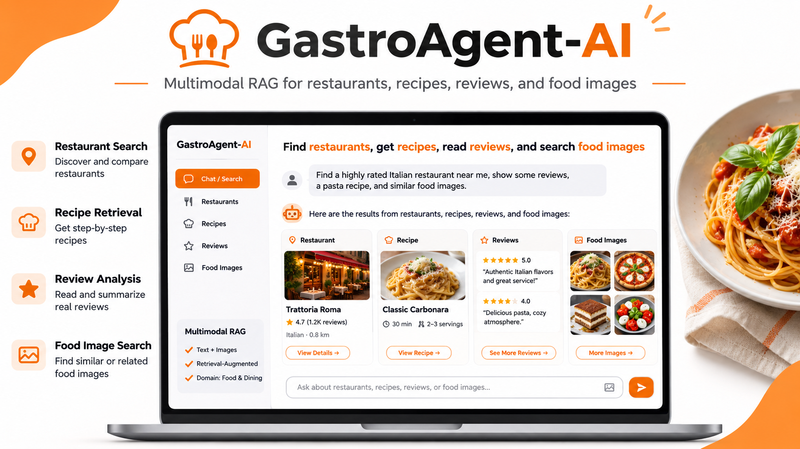
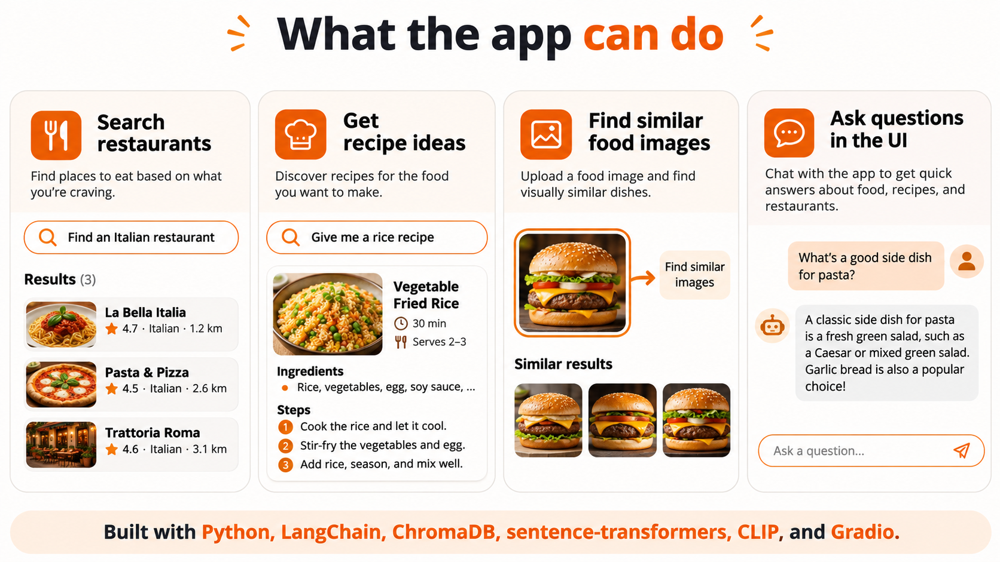
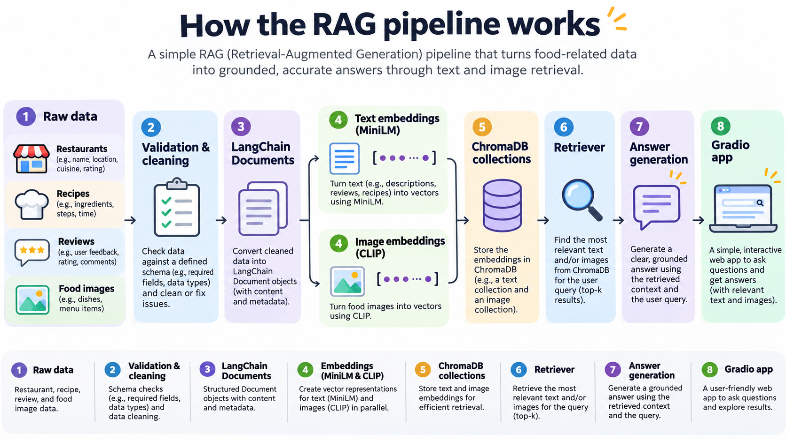
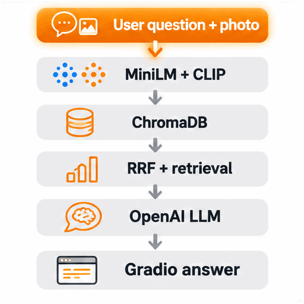
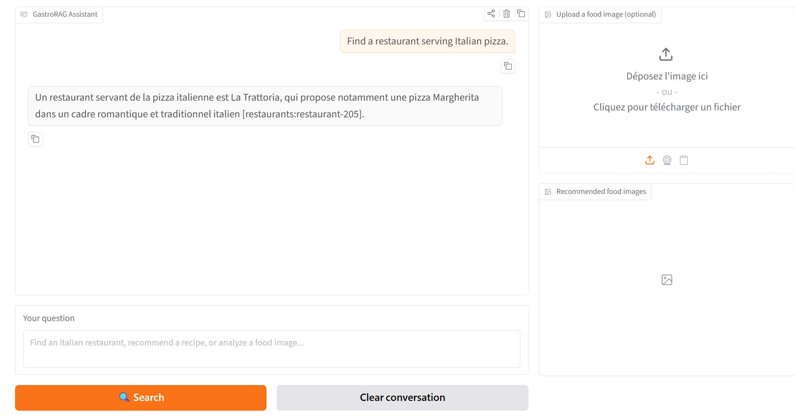
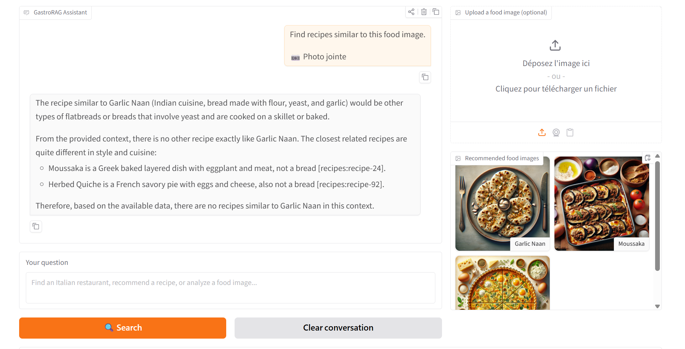
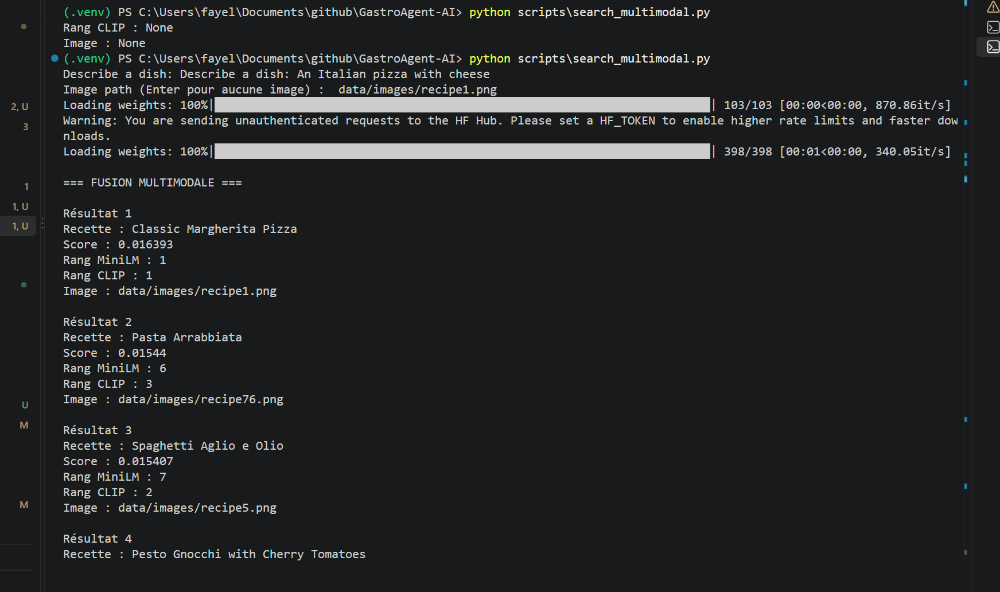
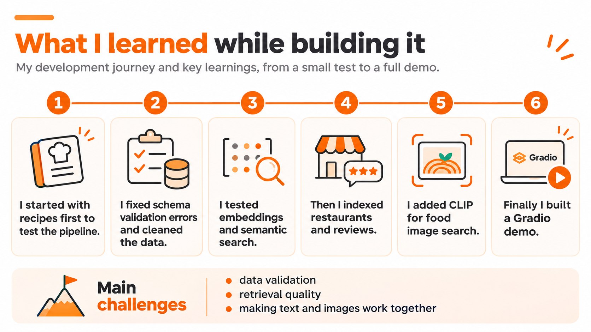
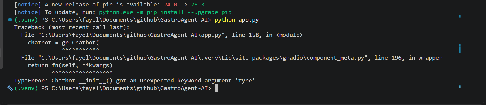

# GastroAgent-AI 🍽️

**A multimodal RAG app for restaurants, recipes, reviews, and food images.**



> **Project status:** Working local demo with Gradio. This is a learning and portfolio project, not a live restaurant booking service. The banner and diagrams are **illustrations**, not screenshots of the running app.

## Why I built this project

I built GastroAgent-AI to practice **Retrieval-Augmented Generation (RAG)** with real Python code, not only notebooks. I wanted to understand the full process: preparing data, checking errors, creating embeddings, searching with ChromaDB, connecting a language model, and building a small web app.

My first goal was simple: **Can I ask a question and retrieve the right recipe?** When that worked, I added restaurants, reviews, and food images. I tested each part before moving to the next one.

## What the app can do



- **Find restaurants** in the sample catalog by cuisine, dishes, location, or atmosphere.
- **Find recipes** by name, ingredients, or a short food description.
- **Search customer reviews** stored in the dataset.
- **Search food pictures with text**, using CLIP.
- **Upload a food photo** and find visually similar recipe images.
- **Combine text and image search** to rank recipe results.
- **Ask questions in Gradio** and get an LLM answer with source IDs.

**Example questions**

```text
Find a restaurant serving Italian pizza.
Give me a recipe with mozzarella and basil.
What reviews are available about Italian food?
Find recipes similar to this uploaded food photo.
```

## My dataset

This project uses a **culinary learning dataset about restaurants in California, USA**, together with recipes, synthetic reviews, and food pictures. The restaurant information comes from a descriptive *California Culinary Map* text, which I structured into records during data preparation. The data is **educational and static**, not a live feed from restaurants.

| Data in ChromaDB | Number of records | What I use it for |
| --- | ---: | --- |
| `restaurants` | **210** | Restaurant profiles, cuisine, dishes, atmosphere, and other descriptions |
| `recipes` | **109** | Recipes, ingredients, and cooking steps |
| `reviews` | **10** | Synthetic user review examples |
| `food_images` | **109** | CLIP embeddings of recipe pictures |

**Important:** 210 means *indexed restaurant records*, not necessarily 210 different or verified restaurants. Some records may refer to the same place. The reviews are synthetic, and I do not automatically connect them to a specific restaurant. The food images belong to recipes; they do not prove a restaurant serves that dish. I do not provide live opening hours, menus, reservations, or verified ratings.

### Data files I worked with

```text
data/
├── raw/                          # Original course dataset
│   ├── Recipes.json
│   ├── Synthetic-User-Reviews.json
│   └── California-Culinary-Map.txt
├── processed/                    # Data prepared for indexing
│   ├── augmented_food_recipe.json
│   ├── augmented_user_review.json
│   └── structured_restaurant_data.json
└── images/                       # Recipe images (when available locally)
```

In the course exercises, the recipe and review data was enriched with image descriptions, and the restaurant text was converted into structured data. I used those processed files in my Python pipeline.

> **Data rights:** Some source files and recipe photos come from educational materials. They may not be included in the public repository. Check their redistribution rights before uploading them. The diagrams in this README are custom illustrations.

## How my RAG pipeline works



**Short animated overview**



I divided the work into two parts:

**1. Data preparation and indexing**

1. I loaded the raw and processed JSON files.
2. I checked the data with **Pydantic** and fixed invalid or missing fields.
3. I created **LangChain Documents** with text and metadata.
4. I used **MiniLM** (`all-MiniLM-L6-v2`) to create **384-dimensional text embeddings** for recipes, restaurants, and reviews.
5. I used **CLIP** (`clip-ViT-B-32`) to create **512-dimensional image embeddings** for the recipe pictures.
6. I saved the vectors in four **ChromaDB collections**.

**2. Search and answer generation**

1. The user asks a question and can upload a photo in **Gradio**.
2. An OpenAI model helps choose the relevant collections and rewrites the search query in English for MiniLM.
3. MiniLM searches the selected text collections. CLIP searches the recipe pictures when recipe retrieval is needed.
4. For recipes, I combine MiniLM and CLIP rankings using **weighted Reciprocal Rank Fusion (RRF)**.
5. I send the retrieved information, not the full database, to the LLM with **LangChain**.
6. The LLM writes an answer and shows source IDs. Gradio displays recipe pictures when available.

For my first fusion experiment I used **60% weight for MiniLM** and **40% for CLIP**, with an RRF constant of **60**. These are starting parameters, not proven optimal values. I do **not** mix the 384-dimensional and 512-dimensional embeddings directly. I combine their **result rankings** using the recipe IDs.

The restaurant and review collections are searched separately. I do not claim that a recipe photo or a review belongs to a restaurant unless the source data proves it.

## Real results from my tests

### 1. Restaurant search in Gradio

I asked:

```text
Find a restaurant serving Italian pizza.
```

The app retrieved a restaurant record, **La Trattoria**, and cited its source ID: `restaurants:restaurant-205`.



*Screenshot from an early local test. The question was in English, but the answer appeared in French. I later changed the answer prompt to use English for my portfolio demo.*

### 2. Image-Based Food Search

I can also upload a food image and search for similar recipes.

For this test, I uploaded a pizza image from the dataset.
The application used CLIP to compare the image with
the stored food embeddings in ChromaDB.

The results are shown in the Gradio interface.




### 3. Text-to-image search with CLIP

I tested this query:

```text
A pizza with mozzarella cheese, tomato and basil
```

The three images returned in my terminal were:

| Rank | Recipe | CLIP cosine distance |
| --- | --- | ---: |
| 1 | Classic Margherita Pizza | **0.6899** |
| 2 | Caprese Salad | 0.7162 |
| 3 | Baked Eggplant Parmesan | 0.7264 |

The Margherita pizza came first, which made sense for this query. **A lower distance means a closer match in this index; it is not a probability of correctness.**

### 4. Combined MiniLM + CLIP search

I searched for:

```text
Description: An Italian pizza with cheese
Image: data/images/recipe1.png
```

The top results were:

| Rank | Recipe | MiniLM rank | CLIP rank | Fused score |
| --- | --- | ---: | ---: | ---: |
| 1 | Classic Margherita Pizza | 1 | 1 | **0.016393** |
| 2 | Pasta Arrabbiata | 6 | 3 | 0.015440 |
| 3 | Spaghetti Aglio e Olio | 7 | 2 | 0.015407 |



The pizza was ranked first by both models. **This test used a catalog image**, so it does not measure how well the system works on completely new photos. External-image testing is an important next step.

## How I built it — step by step



I did not build everything at once. Here is the order that helped me understand and debug the project:

1. **Start small with recipes.** I started with the **109 recipes**. I loaded the JSON, validated the fields, and created LangChain Documents.
2. **Check embeddings first.** I used MiniLM and confirmed I could generate **109 vectors with 384 dimensions**.
3. **Test retrieval before adding more data.** I indexed the recipes in ChromaDB and searched for a pizza with mozzarella and basil. Only after this worked did I continue.
4. **Add restaurants and reviews.** I validated the other datasets and indexed **210 restaurant records** and **10 reviews** in separate collections.
5. **Add image search.** I installed CLIP, encoded **109 recipe pictures**, and created the `food_images` collection with **512-dimensional vectors**.
6. **Combine both models.** I implemented weighted RRF for recipes and compared the text and image rankings.
7. **Build the full RAG.** I added a query planner, retrieval context, and an OpenAI LLM for answers with sources.
8. **Build a UI.** I connected the existing Python functions to **Gradio**, with a chatbot, a photo uploader, and a recipe image gallery.

## Problems I faced and how I fixed them

I learned a lot by fixing errors, not only by making the code work.

| Problem | How I handled it | What I learned |
| --- | --- | --- |
| Some restaurant records had an empty or missing `food_style` value. | I changed the Pydantic schema to accept missing values and adjusted the document metadata. | Real datasets are not always clean. |
| Some questions returned the wrong type of result. | I separated the ChromaDB collections, added collection routing, and later used an LLM to plan retrieval. | Retrieval needs good routing, not only embeddings. |
| MiniLM did not always retrieve the best result for French questions. | I kept the English MiniLM model and added English query rewriting in the RAG planner. | Language mismatch can affect retrieval. |
| My text and image vectors had different dimensions: 384 vs 512. | I stored them in separate collections and fused the **rankings**, not the vectors. | Different embedding models need careful integration. |
| Hugging Face displayed cache and symlink warnings on Windows. | I checked that the models still downloaded and that indexing finished successfully. | A warning is not always a failure. |
| Gradio rejected `type="messages"` in `gr.Chatbot`. | I removed that argument for the installed Gradio version. | Library APIs change between versions. |
| My app answered in French to an English question. | I improved the LLM system prompt for my English-language demo. | Prompt instructions affect the final user experience. |

**One real debugging example:**



This is why I tested **one component at a time** instead of building the entire application before checking anything.

## Tech stack

| Part | Technology |
| --- | --- |
| Language | Python |
| Data validation | Pydantic |
| Documents and RAG chains | LangChain / LCEL |
| Text embeddings | Sentence Transformers — MiniLM |
| Image embeddings | Sentence Transformers — CLIP |
| Vector database | ChromaDB (local persistent store) |
| Rank fusion | Weighted Reciprocal Rank Fusion (RRF) |
| Answer generation and query planning | OpenAI API |
| Web interface | Gradio |
| Development | VS Code, Git, GitHub |

**Scope:** This repository focuses on **multimodal RAG**. I chose to keep **MCP and LangGraph agents** for a separate agentic AI project. They are not required for this RAG app.

## Run it locally

I developed and tested this project on **Windows with PowerShell**.

**1. Clone the repository**

```powershell
git clone https://github.com/YOUR-USERNAME/GastroAgent-AI.git
cd GastroAgent-AI
```

Replace `YOUR-USERNAME` with the real GitHub username.

**2. Create and activate a virtual environment**

```powershell
python -m venv .venv
.\.venv\Scripts\Activate.ps1
```

**3. Install dependencies**

```powershell
python -m pip install -r requirements.txt
```

**4. Add an OpenAI API key**

Create a `.env` file in the project root:

```dotenv
OPENAI_API_KEY=your_api_key_here
OPENAI_MODEL=gpt-4.1-mini
```

**Never commit `.env` or an API key.** API use may incur costs. The first use of MiniLM and CLIP may also download model weights.

**5. Prepare and index the dataset**

Make sure you have the required **processed data and recipe images** in the folders shown above. These educational files may not be distributed in this public repository.

```powershell
python scripts\validate_data.py
python scripts\index_recipes.py
python scripts\index_other_data.py
python scripts\index_images.py
```

The generated `chroma_db/` folder is local and ignored by Git. The indexes must exist before the app can retrieve information.

**6. Start the app**

```powershell
python app.py
```

Open **http://127.0.0.1:7860** in a browser. This address is **local**, not a public portfolio demo link.

### Useful tests

```powershell
python scripts\search_recipes.py
python scripts\search_all.py
python scripts\search_images.py
python scripts\search_similar_images.py
python scripts\search_multimodal.py
python scripts\ask_rag.py
```

## Project structure

```text
GastroAgent-AI/
├── app.py                      # Gradio app
├── requirements.txt
├── README.md
├── assets/                     # README illustrations and screenshots
├── data/
│   ├── raw/
│   ├── processed/
│   └── images/
├── scripts/
│   ├── validate_data.py
│   ├── build_documents.py
│   ├── index_recipes.py
│   ├── index_other_data.py
│   ├── index_images.py
│   ├── search_recipes.py
│   ├── search_all.py
│   ├── search_images.py
│   ├── search_similar_images.py
│   ├── search_multimodal.py
│   └── ask_rag.py
└── src/gastroagent/
    ├── config.py
    ├── data_loader.py
    ├── schemas.py
    ├── documents.py
    ├── retriever.py
    ├── multimodal.py
    └── rag.py
```

## Current limits and future improvements

- **Local demo only:** I have not yet published a stable public hosting link.
- **Static educational data:** No real-time menu, booking, or location verification.
- **Possible duplicate restaurants:** The 210 records have not all been deduplicated.
- **Small review sample:** Only 10 synthetic reviews, with no guaranteed restaurant link.
- **Retrieval is not always perfect:** I need more test queries and better evaluation metrics.
- **Not full conversation memory:** Gradio shows chat history, but each RAG call currently processes the new question independently.
- **Model loading:** Models can take time and memory to load on the local PC.
- **Deployment:** Public hosting needs access to the vector indexes, data files, image permissions, and a server-side API secret.

Next, I would like to test more unseen photos, measure retrieval quality, improve loading performance, and deploy a stable public demo if the dataset license allows it.

## What I learned

The most important lesson for me was to **validate and test every step before adding complexity**. I first made one recipe search work. Then I added more data, image retrieval, RAG generation, and finally Gradio. That process made debugging much easier and helped me understand what each component does.

---

*Personal portfolio project built while learning RAG and multimodal AI.*
