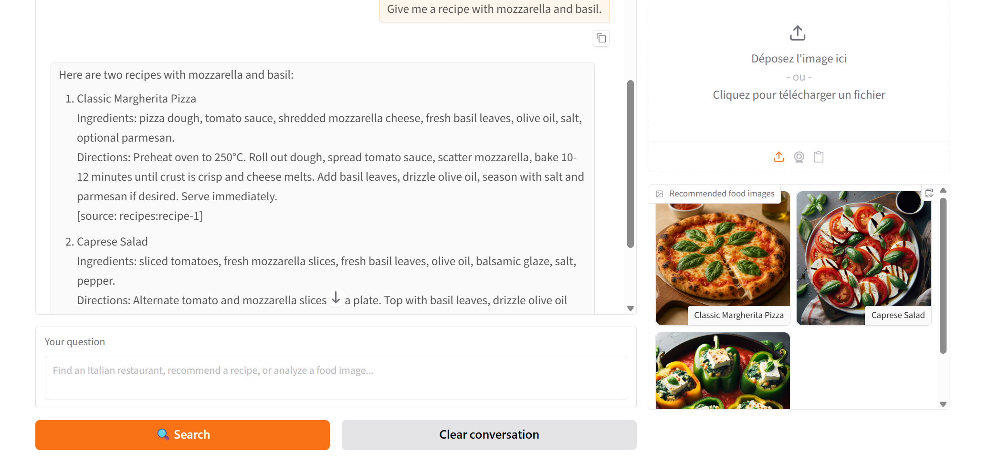
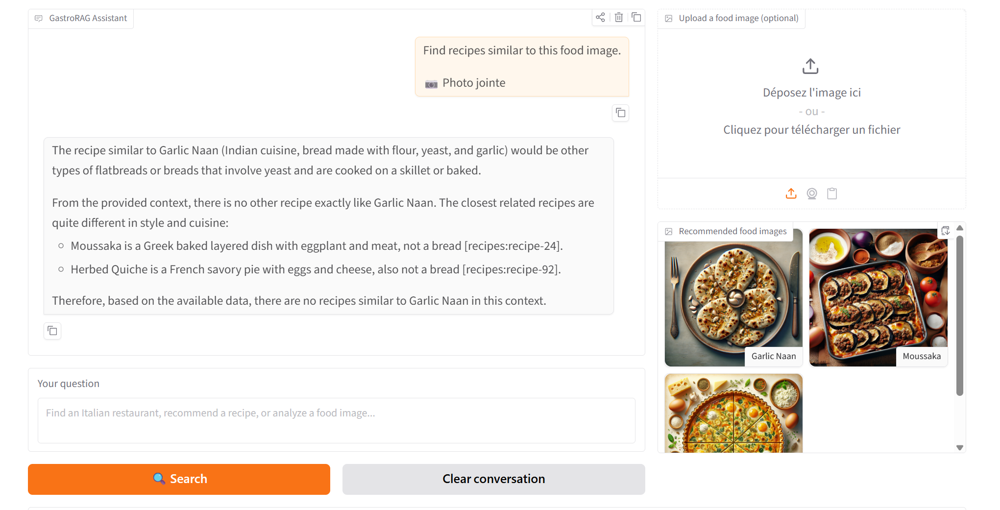

# Screenshot guide for GastroAgent-AI

This file is for me while preparing my GitHub README. It does not need to be shown to recruiters.

All pictures for the README go inside `assets/screenshots/`.

## Windows screenshot steps

1. Open the requested terminal or Gradio page.
2. Press **Windows + Shift + S**.
3. Select the relevant part of the screen.
4. Save the image to the exact path below (or use the PowerShell/Pillow command).
5. Check that no API keys, tokens, or personal information are visible.

Create the screenshot folder (from the project root):

```powershell
New-Item -ItemType Directory -Force -Path assets\screenshots
```

**Save the most recent screenshot from the clipboard (optional):**

```powershell
python -c "from PIL import ImageGrab; from pathlib import Path; im=ImageGrab.grabclipboard(); assert im is not None, 'Capture first with Win+Shift+S'; p=Path('assets/screenshots/gradio_restaurants.png'); p.parent.mkdir(parents=True,exist_ok=True); im.save(p)"
```

Change the filename at the end of the command for each screenshot.

## Screenshots already included in the prepared package

- `assets/screenshots/gradio_restaurants.png` — early Gradio restaurant search, with response in French. **Replace this with a new screenshot in English** after changing your prompt.
- `assets/screenshots/multimodal_fusion.png` — real MiniLM + CLIP RRF results.
- `assets/screenshots/gradio_error_before_fix.png` — Gradio version mismatch during development.

## New screenshots to make

### A. Restaurant search — `gradio_restaurants.png`

```powershell
python app.py
```

Open `http://127.0.0.1:7860` and enter:

```text
Find a restaurant serving Italian pizza.
```

Capture the question and **English** answer. Overwrite `assets/screenshots/gradio_restaurants.png`.

### B. Recipe + gallery — `gradio_recipes.png`

In Gradio, enter:

```text
Give me a recipe with mozzarella and basil.
```

Show the response and the gallery at the same time. Save to `assets/screenshots/gradio_recipes.png`.

Once captured, insert these lines below the restaurant screenshot in `README.md`:

```markdown
### Recipe answer and picture gallery


```

### C. Uploaded photo — `gradio_image_search.png`

In Gradio, upload `data/images/recipe1.png` and enter:

```text
Find recipes similar to this food image.
```

Capture the uploaded picture, answer, and recommendations; save to `assets/screenshots/gradio_image_search.png`.

Then insert:

```markdown
### Search with an uploaded food image


```

### D. Collection sizes — `chromadb_collections.png`

In a VS Code terminal, execute:

```powershell
python -c "import chromadb; c=chromadb.PersistentClient(path='chroma_db'); names=['restaurants','recipes','reviews','food_images']; [print(f'{n}: {c.get_collection(n).count()}') for n in names]"
```

Expected for the indexed dataset (if unchanged): restaurants 210, recipes 109, reviews 10, food_images 109. Screenshot filename: `assets/screenshots/chromadb_collections.png`.

### E. CLIP search — `clip_results.png`

```powershell
python scripts\search_images.py
```

Enter:

```text
A pizza with mozzarella cheese, tomato and basil
```

Capture the three results. Save to `assets/screenshots/clip_results.png`.

### F. RRF result — `multimodal_fusion.png` (already included)

```powershell
python scripts\search_multimodal.py
```

Enter:

```text
Describe a dish: An Italian pizza with cheese
Image path (Enter pour aucune image) : data/images/recipe1.png
```

The existing screenshot already shows the ranking and scores. Replace it only if you want a cleaner crop.

## GitHub commit

```powershell
git add README.md assets/
git commit -m "Document multimodal RAG with diagrams and real test screenshots"
git push
```

Never commit the `.env` file or private/course images without permission.
